# Atmos — weather, beautifully clear

Atmos is a live weather app with an iPhone-style liquid glass design. Frosted glass panels sit on top of an animated scene that follows the real weather of the place you search: sun rays on clear days, drifting clouds, rolling fog, rain on the glass, lightning, falling snow, and a slowly turning night sky full of stars.

**Live demo:** <https://weather-forecast-one-murex.vercel.app>

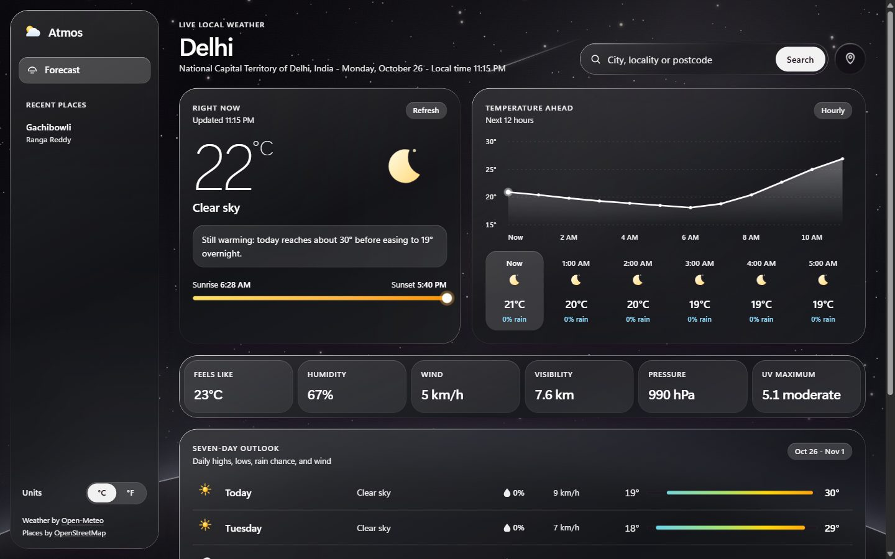

## Every condition has its own scene

The background reacts to the live weather and to day or night at the searched location. All screenshots below are from the live app with real weather data.

<table>
  <tr>
    <td width="50%">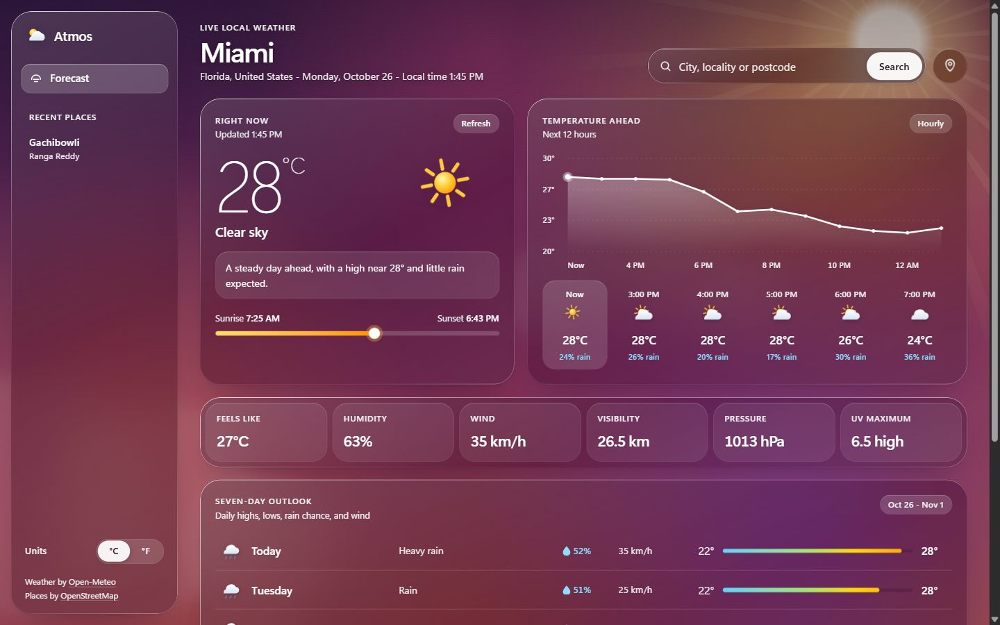<br /><b>Clear day</b> — soft sun with slowly turning light rays (Miami)</td>
    <td width="50%">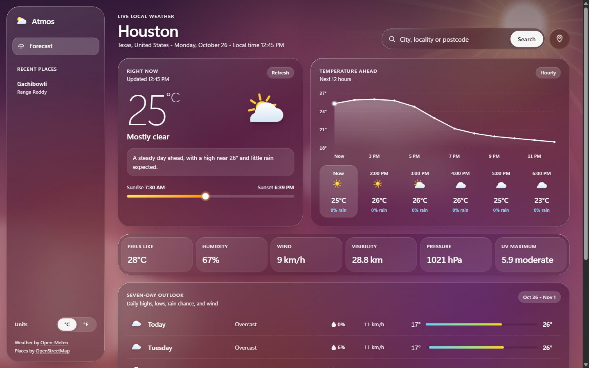<br /><b>Partly cloudy</b> — sun with puffy clouds drifting at three depths (Houston)</td>
  </tr>
  <tr>
    <td>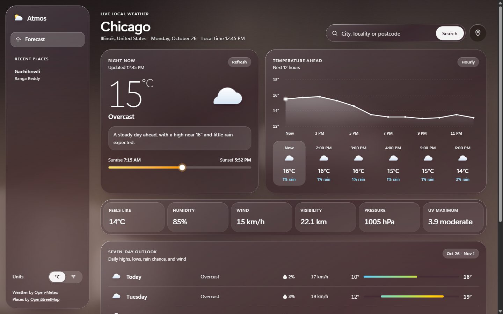<br /><b>Cloudy</b> — fuller cloud banks on a warm mocha sky (Chicago)</td>
    <td>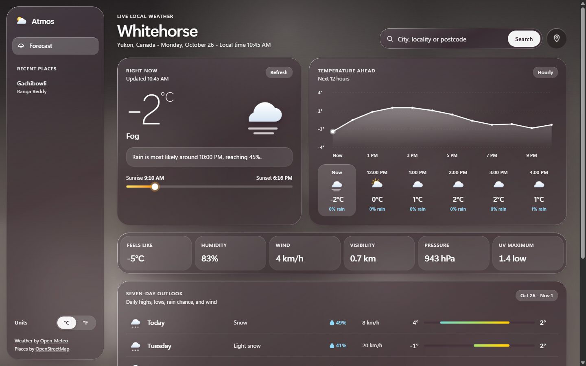<br /><b>Fog</b> — banks of mist rolling across the screen (Whitehorse)</td>
  </tr>
  <tr>
    <td>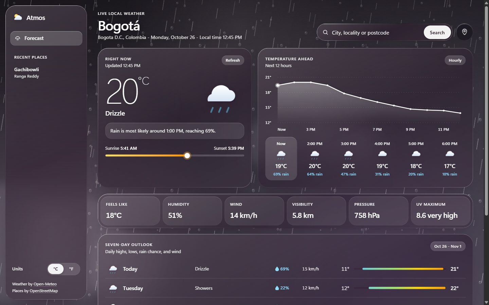<br /><b>Rain</b> — falling rain and drops beaded on the "window" (Bogotá)</td>
    <td>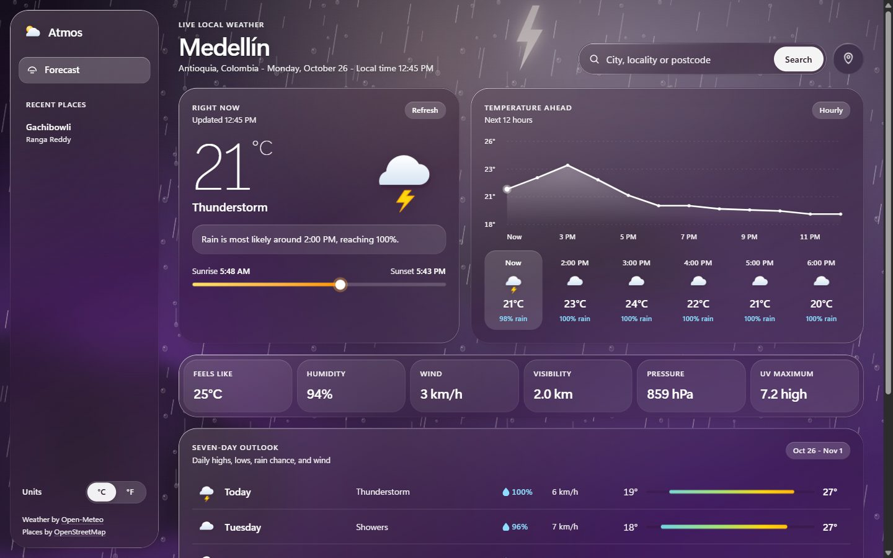<br /><b>Storm</b> — dark clouds and lightning in sync with the flash (Medellín)</td>
  </tr>
  <tr>
    <td>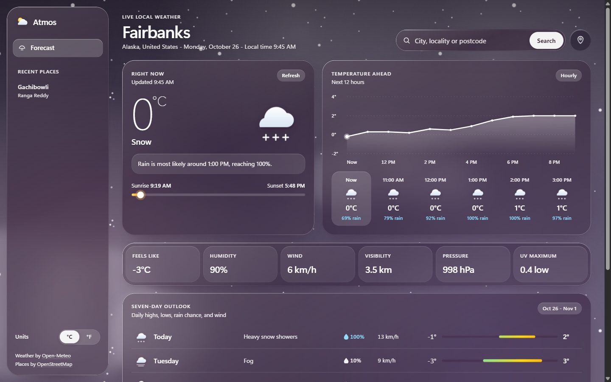<br /><b>Snow</b> — flakes drifting down at two depths (Fairbanks)</td>
    <td><br /><b>Clear night</b> — stars turning around a pole star, the Milky Way, shooting stars and Earth's horizon (Delhi)</td>
  </tr>
  <tr>
    <td>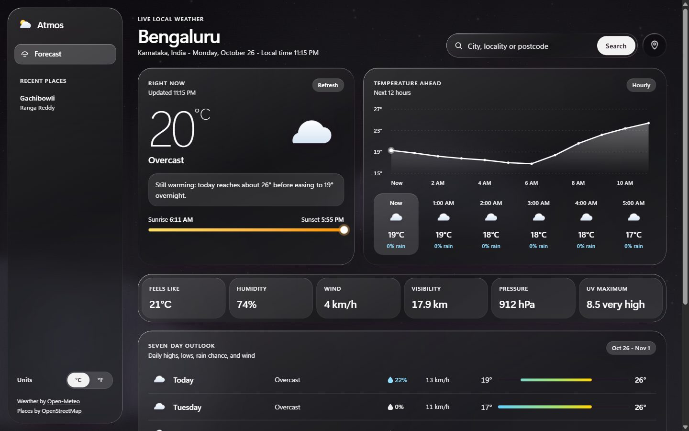<br /><b>Cloudy night</b> — grey clouds over a dark sky (Bengaluru)</td>
    <td>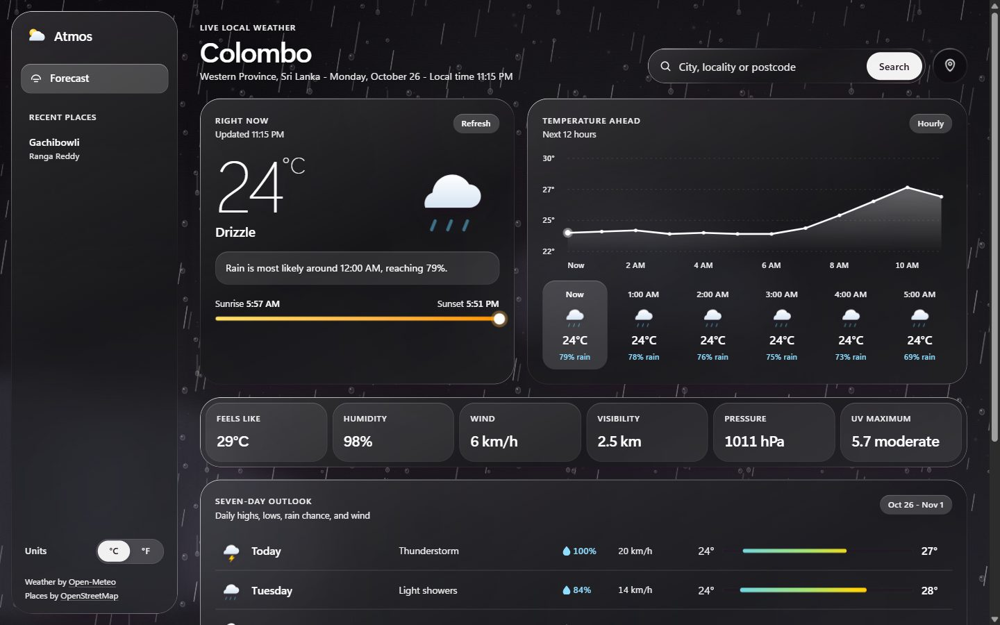<br /><b>Rainy night</b> — rain on a dark sky (Colombo)</td>
  </tr>
</table>

### On your phone

<p>
  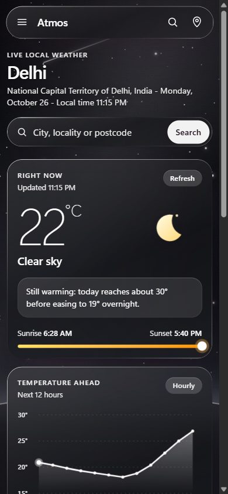
  &nbsp;&nbsp;
  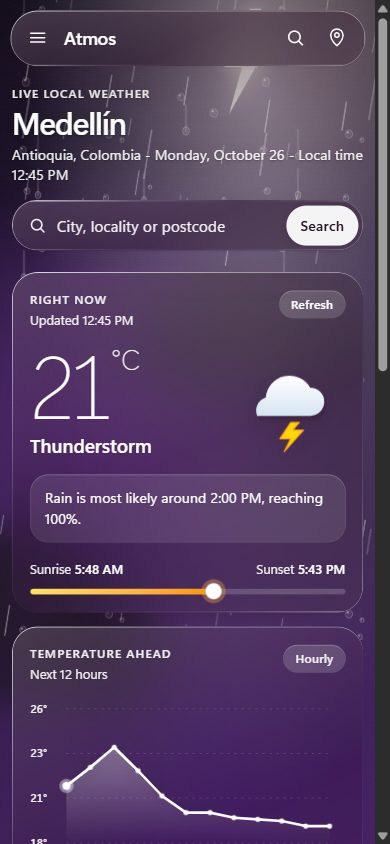
</p>

## Features

- **Live weather** for any city, plus Indian localities and six-digit PIN codes (for example `Gachibowli` or `507211`).
- **Current conditions** with a large reading, a short summary of the day, and sunrise/sunset progress.
- **Next 12 hours** as a temperature chart and an hourly strip with rain chance and day/night icons.
- **Six details**: feels like, humidity, wind, visibility, pressure and UV.
- **Seven-day outlook** with iOS-style temperature range bars on a shared week scale.
- **Your location**, recent places, Celsius/Fahrenheit, and shareable URLs for any place.
- **Responsive** layouts for desktop, tablet and phone.

## How the scenes work

- Plain HTML, CSS and JavaScript, with no framework, build step or image assets for the scenes. Stars, rain, snow, raindrops and the lightning bolt are small inline SVG patterns.
- Each scene layer only renders for its own weather, and all motion uses GPU-friendly `transform` and `opacity` animations.
- White text stays at a contrast ratio of 4.5:1 or better on every scene. The glass dims what's behind it, and a soft scrim plus text shadow protect the location heading.
- **Reduce motion** stops all animation, and **reduce transparency** swaps the glass for solid panels and hides the scenes.

> **Want to see a particular scene?** Search for a city that has that weather right now. Weather changes, so look for one where it's currently raining, snowing or storming, or where it's night.

## Run locally

This is a dependency-free static app. Serve the directory with any local web server:

```bash
python -m http.server 4173
```

Then open `http://localhost:4173`.

## Deploy to Vercel

```bash
vercel --prod
```

No environment variables or API keys are required.

## Data sources

- Weather forecasts and city search by [Open-Meteo](https://open-meteo.com/).
- Indian locality and PIN code search, and naming of your current location, by [OpenStreetMap](https://www.openstreetmap.org/copyright) (Nominatim).

Forecasts are estimates. Check official local alerts before making weather-sensitive plans.

---

Atmos started as a college weather project and was rebuilt as a modern, production-ready static app.
